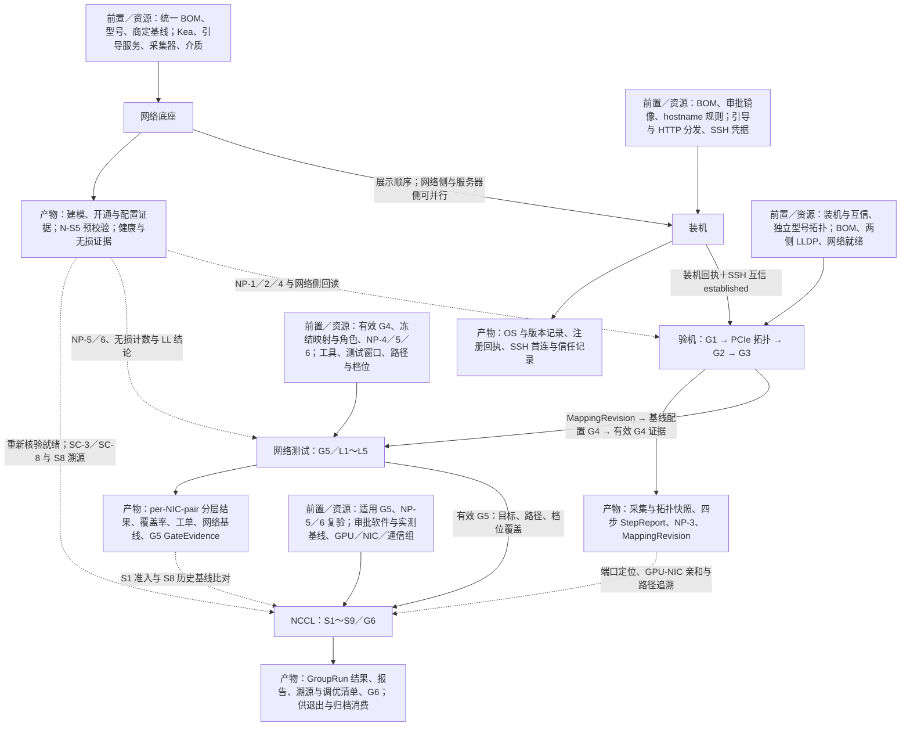

# keel 交付流程鱼骨图与产物消费链——开发实现视角

依据：用户本次上传的 `PRD(3).md`、`DESIGN-SYSTEM(3).md`，均为 v3.0.3。编制日期：2026-10-26。

本文是对设计要求的整理，不代表相关能力已经开发完成或现场验收通过。仅使用上述两份附件；未将未提供的 ARCHITECTURE、ACCEPTANCE 等文件视作已经核验的依据。

**目标读者：专业开发人员，不要求具备机房实施经验。** 本文按“业务对象 → 输入来源 → 执行主体 → 判定条件 → 产物 → 下游消费 → 失效／恢复”描述流程。现场术语保留原名，但转换成可编码的数据依赖和状态约束；未定义的接口、数据库字段或调度策略不伪装成既有规格。

## 1. 绘图口径

- **主干保留用户指定顺序：网络底座 → 装机 → 验机 → 网络测试 → NCCL。** 每个阶段挂接“前置／资源”和“产物／消费者”两组鱼刺。
- **验机的正式功能边界是 FR-4；五层网络测试是 FR-11／G5。** 验机内部的网络核查是 G2 四步线序验证；G5 与它属于同一条交付验证链，但不能合成一个检查。
- **“验机 → 网络测试”的连接必须包含 G4 基线配置。** 五段展示不意味着删除这一业务步骤。普通门禁链仍为 G1 → G2 → G3 → G4 → G5 → G6；PCIe 拓扑位于 G1 与 G2 之间，不另占 G 编号。
- **主干表示业务阅读顺序，不表示网络底座必须整体结束才能装机。** FR-17.3 允许网络侧与服务器侧并行；真正的跨域硬前置在 G2、G5、G6 准入时按范围核验。
- **N-S0～N-S9 是网络阶段证据标签；NP-1～NP-6 是前置断言；G1～G6 才是服务器门禁。** 不把三者混成一套阶段编号。
- **已知**：附件有明确规定。**待确认**：附件未给出具体策略或表述存在未消解的冲突。下文“绘图组织”仅用于安排信息，不新增业务实体、判据或接口。

依据：PRD §1.5、FR-4、FR-11、FR-17.3；DESIGN-SYSTEM §3、§4.11、§5.3～5.5。

### 1.1 先建立开发所需的对象模型

| 原文对象／术语                                | 无现场经验的开发者应如何理解                                  | 实现时的约束                                                 |
| -------------------------------------- | ----------------------------------------------- | ------------------------------------------------------ |
| 服务器、交换机                                | 两类不同的受管设备。服务器运行 OS、驱动与测试；交换机承载端口连接、网络转发及无损配置    | “服务器 SSH 可达”和“目标计算网络已通过测试”是不同事实；采集／执行通道与被测业务通路分开建模     |
| Machine／Component／PhysicalPort         | 整机、部件、物理端口的稳定身份层级；网卡和 GPU 是部件，端口是布线和故障定位的锚点     | 不能用当前 OS 接口名、BDF 排序或界面行号代替稳定 ID；身份在 G3 前已存在            |
| 物理端口位、OS 接口名、永久 MAC、PCI BDF、交换机端口      | 同一连接链上不同层次的标识，分别描述面板位置、操作系统对象、网卡地址、PCIe 位置、远端位置 | 通过 PortModel／MappingRevision 关联；禁止假设这些标识天然相等或顺序相同      |
| 线缆／端口对                                 | BOM 中用两个端口 uid 表达的一条预期物理连接；实际连到哪里要靠采集核验         | 预期端点与实际邻居分别存；插错线不能通过覆盖 BOM 让验证“通过”，改 BOM 也要走批准的变更      |
| GPU-NIC 亲和／PCIe 拓扑                     | 主机内部 GPU 到 NIC 的实际连接路径、NUMA 归属和链路能力，与设备间线缆是两类关系 | FR-4.8 核对内部关系，G2 核对外部连接；GPU:NIC 数量和关系来自机型，不硬编码1:1或固定8卡 |
| rail                                   | BOM／项目网络方案中的分组属性，用于配对、配置与按轨核查                   | 直接消费已批准方案，不自行用网卡编号或 Leaf 名称猜测 rail，也不额外发明跨 rail 策略     |
| LLDP                                   | 采集“本端端口实际看见哪个对端”的邻居发现信息                         | G2 同时需要主机侧、交换机侧及 BOM 期望三方数据；FDB／ARP 只能补充               |
| DOM／DDM                                | 光模块遥测，如温度和收发光功率；主机侧与交换机侧是不同观测来源                 | 缺数据不等于数值0，也不等于模块损坏；保留 source、采样时间、能力与质量标记              |
| RDMA／RoCE 通路                           | FR-11 用专门读／写打流验证的业务通路                           | ping成功只覆盖 IP 可达性，不能替代 ib_write_bw／ib_read_bw 的检查       |
| PFC／ECN／CNP                            | 分别对应按优先级逐跳暂停、显式拥塞标记、RoCEv2 拥塞通知                 | 读取能力／计数和配置，再按版本化规则判定；不能把“没有收到数据”当“没有拥塞”                |
| Golden／IN_SYNC                         | intended 与设备实际 running 的配置比对结果                  | 下发命令退出码0、ZTP完成都不是配置已生效的充分证明，需复采验证                      |
| MappingRevision／ConfigSet／GateEvidence | 分别表达已验证映射、版本化配置、允许后续工作使用的证明                     | 三者不是一个“完成”布尔值：映射正确、配置生效、测试通过分别保留记录与版本                  |
| 金丝雀                                    | 先在少量设备执行并验证，成功后才扩大批次                            | 不能把整批派发成功当成金丝雀验证已通过                                    |
| GroupRun／GroupAttempt                  | 一次 NCCL 通信组及其整组尝试                               | 同一组的参与者须统一启动；失败后整组恢复，不能把各 rank 当成独立普通任务重试              |

### 1.2 现场动作与系统动作的责任边界

| 动作                       | 执行主体                   | 系统可记录／判定的内容                                            |
| ------------------------ | ---------------------- | ------------------------------------------------------ |
| 商定网络方案、QoS和地址规则          | 客户与网络工程师               | 导入商定结果并版本化；不由平台自动发明方案                                  |
| 接线、换光模块、换网卡等实物处理         | 现场人员                   | 工单记录处理动作和新旧部件信息，随后自动定向重验；“人员填了已处理”不是检查 PASS            |
| 安装 OS、采集、执行配置、打流、运行 NCCL | 平台 Flow 调用适用执行通道       | Execution／TaskAttempt 回执、采集快照、原始输出、版本引用                |
| 验证结果判定与准入检查              | 后端判定／编排逻辑              | 明确区分任务执行状态、检测结果、证据可消费性；前端不自行推算门禁                       |
| G2 最终线序确认、允许的门禁豁免、G6报告评审 | DL 等原文指定角色             | 保存操作人、时间、范围、版本和审批记录；DL=交付组长，NE=网络工程师，NH=网络负责人，DE=交付工程师 |
| 网络生产配置审批                 | 普通级 NE＋DE；Critical追加NH | 按审批快照执行，修改计划不得继续复用旧审批                                  |

### 1.3 将流程拆成三种不同的逻辑

- **控制流：** 哪些前置允许任务开始，失败或缺证据时阻断哪个范围。主线顺序不意味着所有设备和所有域全局串行。
- **数据流：** 上游具体产出哪个快照／映射／配置／报告，下游引用哪个版本和覆盖范围。引用“最近一条成功记录”不等于依赖有效。
- **事实与状态：** BOM／型号／商定基线表达期望；设备快照表达观测；MappingRevision表达确认关系；GateEvidence表达门禁结论。`lldp`／`mapped`／`netverified` 等设备状态用于呈现流程位置，不能代替证据校验。

标识符也要分开：N-S为网络阶段标签，NP为跨域断言，G为门禁，G2的Step为线序步骤，G5的L1～L5为测试层级，NCCL的S1～S9为执行步骤，LL为无损规则，SC为NCCL判定场景，T为故障分类。

## 2. 鱼骨图：主干、前置与产物消费

以下 Mermaid 使用竖向主干，避免五条长鱼刺横向挤压。主干实线为业务顺序；侧枝为前置或产物；虚线为跨阶段消费。各侧枝的完整字段见第 3～8 节。



**绘图时必须保留的旁注：** 网络底座分阶段供给证据；N-S5 的服务器接入口 pending 不等于 NP-3 PASS；G4 是主干连接中的必经环节；图中任何“产物”都须按目标、版本与有效期消费，不能只看机器状态或项目总体通过率。

## 3. 五条主鱼刺的完整定义

### 3.1 网络底座（FR-0）

**前置与输入**

- 项目模板与已商定的网络配置基线；方案和参数取值由客户与网络工程师决定，平台承接导入、版本化和执行。
- 统一 BOM：交换机、端口、breakout 子口、线缆两端、光模块、型号与位置、角色、rail／pod、凭据批次等。标准导入包同一次事务提交服务器与网络物料；BLOCK 问题未清零不能进入 N-S4／装机。
- DeviceModelVersion、已发布网络模板、参数目录、审批可用的 NOS／固件／ZTP 脚本等介质。
- Kea、引导服务、采集器、仓库环境自检通过；网络设备管理与采集通道、有效凭据、审批及灰度执行能力就绪。

**内部工作及判定**

| 网络标签           | 工作与产物                                                   | 消费关系及边界                                                 |
| -------------- | ------------------------------------------------------- | ------------------------------------------------------- |
| N-S0 立项与标准     | 套用项目模板，确定版本、基线和策略                                       | 后续全部阶段消费                                                |
| N-S1 BOM 导入与建模 | 统一物料、稳定端口身份、连接期望、导入问题清单                                 | N-S2～N-S6、装机、G1、G2；产生 NP-1 的建模依据                        |
| N-S2 网络实施规划    | 商定方案工程化、地址和命名分配、模板变量绑定、批次与依赖计划                          | N-S3／N-S4、配置渲染；平台不自行设计网络方案                              |
| N-S3 环境就绪      | Kea／引导服务／采集器／仓库自检                                       | N-S4 准入                                                 |
| N-S4 ZTP 开通    | 身份反查、最小隔离／管理配置、可管理状态与引导回执                               | 后续配置与采集；**仅 ZTP 成功不等于生产配置 IN_SYNC，也不足以单独证明 NP-2**       |
| N-S5 网络侧线缆预校验  | BOM 与交换机 LLDP、FDB／ARP、端口和可采链路证据                         | G2 三方比对的网络侧基础；未装机服务器接入口保持 pending，不预先产生 NP-3 PASS       |
| N-S6 配置闭环      | intended、Doublecheck、快照／diff、修复计划、分析／预演、审批、PushJob、复采比对 | 与 N-S4 完成记录共同支持 NP-2；版本化网络意图供 G4 对齐；N-S6 的并行时序歧义见第 10 节 |
| N-S7 全网健康      | BGP 邻居 100% Up、光功率阈内、PTP 锁定；无损能力、计数与 LL 结论              | NP-5／NP-6 → G5、G6；健康失败使后续准入 BLOCKED，不能记 PASS            |
| N-S8 网络交付验收    | 网络侧验收证据包                                                | CMDB、N-S9                                               |
| N-S9 结果导出与移交   | 设备／端口／互联／地址／状态清单与 intended、running 版本快照索引               | PortModel／CMDB、资产系统和排障视图；导出前引用与快照一致率 100%               |

网络配置主链：**意图承接与渲染 → Doublecheck → 备份采集 → 比对 → 修复计划 → Batfish／预演 → 审批 → 下发 → 复采验证**。Doublecheck 的语法、语义、一致性任一层 FAIL 均阻断下发；设备预检 FAIL 阻断对应设备、WARN 须逐项确认。生产变更必须经过审批，未装机主机的 LLDP 不作为首次开通的虚假硬前置。

**对服务器域的产物出口只有 FR-0.8**：就绪、LLDP 回读、线缆结论、无损与打流计数、光模块与日志证据、网络交付基线；第三方适配器也必须满足同一契约。N-S8／N-S9 导出完成不是文档规定的 G2／G5 统一前置。

依据：PRD §1.4～1.5、FR-0.1～FR-0.8、FR-2.1、附录 A.8.4。

### 3.2 装机（FR-2）

**输入／资源：** 已导入且绑定型号的 BOM、目标 SN／MAC、hostname 规则、已审批且兼容的 OS 镜像与参数版本；UEFI HTTP Boot 优先、Legacy PXE 兜底，ProxyDHCP＋iPXE＋HTTP 分发；cloud-init、平台 SSH 公钥及受控凭据。

**流程：** iPXE 硬件预检（NIC 数量、GPU 在位、磁盘健康，失败中断）→ 镜像安装 → 首次启动 → 装机注册回调 → SSH 首连验证。注册回调使用绑定请求、SN／MAC、项目的一次性令牌，DHCP fingerprint 仅为辅助证据。镜像先金丝雀验证，记录 OS 与预装驱动版本。

**产物 → 消费者：** 已装 OS、hostname／版本记录、注册回执、`Machine.ssh_trust=established` → G1 预收集及后续 SSH 作业。SSH 互信失败进入互信修复队列，不能以“OS 已启动”代替可执行验机。客户标准镜像不支持注入时使用 FR-1.2 的受控互信初始化路径。

**资源边界：** agent 不是 G1～G6 的必备前置，Agentless 能完成交付；门禁判据不因此降低。

依据：PRD FR-1.2、FR-1.8～1.10、FR-2、§5。

### 3.3 验机（G1、PCIe 拓扑、G2、G3）

| 子环节              | 前置与资源                                    | 检查及通过条件                                                                                                                                     | 产物 → 后续消费者                                                           |
| ---------------- | ---------------------------------------- | ------------------------------------------------------------------------------------------------------------------------------------------- | -------------------------------------------------------------------- |
| G1 预收集           | 装机回调、SSH established；BOM、采集脚本及主机／BMC 通道  | GPU UUID／BDF／在位／NVLink／HBM；NIC 永久 MAC／BDF／接口 PF/VF／链路速率／RDMA／DOM；系统 SN／BMC IP／OS／驱动／拓扑摘要。字段完整率 100%、永久 MAC 与 BOM 一致；DOM 不可读记录降级，放行边界见第 10 节 | 预收集快照＋G1 证据 → FR-4.8、G2、PortModel／网口监控                               |
| PCIe 拓扑验证 FR-4.8 | 有效 G1、独立审批的型号拓扑；sysfs、lspci、nvidia-smi   | 上游路径、NUMA、NVLink 矩阵、LnkCap／LnkSta 与型号槽位设计一致。期望不能来自待验实测 BDF 排序                                                                               | PciTopologySnapshot＋TopologyDiff → G2 Step 1；通过的亲和关系还被 G3／G4／NCCL 消费 |
| G2 四步线序验证        | 本次逐目标 G1、拓扑通过、NP-1／NP-2／NP-4、网络域在线       | 四步顺序与三方比对见第 5 节，最终 DL 确认                                                                                                                    | GPU-NIC 关系表、两侧 LLDP、差异与工单、NP-3、线序确认记录、四步 StepReport＋G2 → G3          |
| G3 Mapping 库建立   | G2 通过、NP-3、已确认端口对写入 PortModel；型号、角色与采集关系 | 启用角色所需 GPU／NIC／端口映射 100% 覆盖且无冲突                                                                                                             | 不可变 MappingRevision＋G3 → G4、G5／G6 定位与溯源                              |

**此阶段禁止提前下发正式 GPUrail／RoCE 配置。** G1 只允许 LLDP 所需临时接口 up 与 lldpd。Machine／Component／PhysicalPort 在 BOM／预收集阶段即存在，G2 可以引用；不能错误要求先发布 G3 Mapping 才能做 G2。

### 3.4 必经连接：基线配置 G4（FR-5）

**输入／资源：** 有效 G3、MappingRevision、型号与角色绑定、参数目录、审批介质、服务器 ConfigSet，以及网络侧导入的 QoS 意图。

**处理：** 按 GPUrail 渲染 NIC IP／路由／策略；按型号能力执行网卡分割；生成 GPU-NIC 绑定与 NUMA 方案；导入 DCQCN／PFC／ETS／MTU 等 RoCE 预配置；执行适用的驱动／依赖／固件更新、读回和验证。服务器 DSCP、PFC prio、ECN、MTU 与网络意图不一致时阻断导入，由 NE／NH 决定修正一侧。

**通过与产物：** 配置拉齐后抽检验证通过 → ConfigSet 版本、参数快照、应用回执／读回证据＋G4 → 解锁 G5。抽检比例与如何证明覆盖本次目标，附件未给出，列为待确认。普通配置失败走重配置／按能力恢复，不能假定所有固件均可回滚。

### 3.5 网络测试 G5（FR-11）

**输入／资源：** 本次目标有效 G4、冻结 MappingRevision 与角色、无阻断本次普通测试的未处置告警、执行前新鲜 NP-4、NP-5／NP-6；按版本审批的打流工具、目标 NIC／端口／rail、测试窗口与资源互斥、test_profile、required_path_coverage。Agent 或 SSH 执行均可。

**处理：** L1 链路层 → L2 IP／ARP → L3 RDMA 通路 → L4 端到端流量 → L5 PFC／死锁与拥塞。这个顺序表达文档的检查层级；严格串行、失败短路及 L5 观测调度未被完整定义，见第 6、10 节。

**产物 → 消费者：** per-NIC-pair 分层结果、带宽／丢包／PFC 计数、热点覆盖、失败分类及工单、连通性报告与 G5 GateEvidence → NCCL S1 准入与 S8 历史基线比对。只有本次目标及 required_path_coverage 所需证据全 PASS 才是 G5 PASS；审批豁免为 WAIVED，抽样不等于全路径覆盖。

### 3.6 NCCL（FR-6／G6）

**输入／资源：** 与本次通信组目标／路径／档位匹配的有效 G5；NP-5／NP-6 重新核验及网络就绪核验；GPU 健康、驱动／CUDA／NCCL／nccl-tests 精确兼容组合、审批介质、独立实测性能基线、拓扑／亲和配置；GPU／NIC／整组资源预留。

**执行：** S1 环境预检 → S2 环境准备 → S3 单机档 → S4 跨机档 → S5 全集群档 → S6 结果回收 → S7 报告生成 → S8 失败溯源 → S9 调优清单汇总。

- GroupRun 冻结成员、GPU、rank/world_size、rendezvous、接口、算子／消息大小与基线；先预留整组资源，再统一启动。组内失败终止其余参与者；重试创建新 GroupAttempt 并整组重建。
- 报告区分 grouped_coverage 与 single_communicator；不能把分组覆盖说成全域单通信组，也不能把组级 busbw 复制为各节点独立性能。
- S8 消费 PortModel／拓扑、G5 路径基线、DCGM、工单，以及 FR-0.8.4 的交换机无损计数和 LL 结论。
- **纯机内 NVLink 诊断例外：** 有效 G4 与资源门禁下可以先运行；仅产生机内诊断证据，不能据此产出 G6 交付通过。

**产物 → 消费者：** GroupRun JSON、聚合指标与 SC 场景矩阵、HTML／PDF／CSV 报告、网络溯源工单、调优清单 → DL 评审 G6（报告达标＋调优清单确认）→ 解锁优雅退出。报告和网络基线进入归档链；G6 本身不等于 cleanup 完成或项目 delivered。调优落地走 ConfigSet／网络修复计划审批，变更后按失效范围重测。

## 4. 网络前置与产物消费账本

### 4.1 NP-1～NP-6

| 前置断言                   | 已知判据／生产方                                                     | 消费方                      | 缺失或不满足                                         |
| ---------------------- | ------------------------------------------------------------ | ------------------------ | ---------------------------------------------- |
| NP-1 交换机与端口已建模         | FR-0.1／统一 BOM，交换机及端口存在，breakout 子口独立成行                       | G2 启动、Step 3             | 禁用并显示缺失对象                                      |
| NP-2 交换机已开通且配置 IN_SYNC | FR-0.3＋FR-0.4，ZTP 完成且最近 Golden 比对无 Critical 漂移               | G2 就绪；FR-11.2 网络就绪核验     | 禁用，提示目标配置未同步；IN_SYNC 与非 Critical 漂移口径歧义见第 10 节 |
| NP-3 线序确认有效            | **G2 Step 2／3** 三方比对后端口对 PASS，并写入 PortModel；G2 Step 4 完成最终确认 | G3、依赖已确认线序的后续任务          | 阻断 Mapping 发布；不是 G2 的启动前置                      |
| NP-4 网络就绪证明新鲜          | FR-0.8.1，执行前刷新，默认 TTL 30s，LLDP 可读                            | G2、G5；G6 S1 还要求网络就绪核验    | 禁用；已进入预检则 BLOCKED                              |
| NP-5 全网健康门禁通过          | FR-0.6.1／N-S7：BGP 100% Up、光功率阈内、PTP 锁定                       | G5、G6 S1 复验              | 阻断准入；DL 有效审批为 WAIVED，不改写为 PASS                 |
| NP-6 无损基线可用或显式降级       | PFC／ECN／CNP／队列等能力与计数，缺失为 unknown＋降级标记                        | G5 L3／L5、G6 SC-3／SC-8、监控 | 必需证据不足为 BLOCKED；显式标记降级本身不意味着获准通过               |

### 4.2 关键产物链

| 生产环节             | 产物                                                             | 后续消费／用途                              |
| ---------------- | -------------------------------------------------------------- | ------------------------------------ |
| 统一 BOM／型号库／项目模板  | 稳定 Machine／Component／PhysicalPort、期望连接、独立型号拓扑、角色与版本基线          | 网络建模／配置、装机、G1、G2、G3、G4、测试参数与证据版本绑定   |
| 网络底座             | 网络就绪、N-S5 预校验、交换机 LLDP／DDM、配置与健康证据                             | G2 三方比对；G4 意图对齐；G5／G6 准入和解释          |
| 装机               | 注册与 SSH 首连回执、OS／驱动版本                                           | G1 与后续执行通道                           |
| G1               | 主机 GPU／NIC／系统采集快照                                              | PCIe 拓扑、G2 本地 MAC 一致性核对、PortModel／监控 |
| FR-4.8／G2 Step 1 | PciTopologySnapshot、TopologyDiff、GPU-NIC 关系表                   | G2 后续步骤、G3 亲和映射、G4 绑定、NCCL SC-4 与 S8 |
| G2 Step 2        | 主机与交换机 LLDP 快照、本地永久 MAC 清单                                     | Step 3 三方比对；缺测不作为“空匹配成功”             |
| G2 Step 3        | 端口对结论、差异／工单、PortModel.switch_port、NP-3                         | Step 4 确认；结合 G2 通过后支持 G3             |
| G2 Step 4        | 四步 StepReport 链、关系表版本、确认人／时间、G2                                | G3 Mapping 发布                        |
| G3               | 不可变 MappingRevision，物理端口↔OS 接口↔永久 MAC↔BDF↔交换机端口＋GPU 亲和         | G4 渲染、G5 测试对与端口定位、G6 绑定和失败溯源         |
| G4               | ConfigSet／参数版本、应用及读回结果、G4                                      | G5 准入；允许的纯机内 NVLink 诊断               |
| 网络无损采集与规则        | PFC／ECN／CNP／队列／缓冲／WJH、LL-01～LL-07@version、能力及 unknown 标记       | G5 L3／L5；G6 SC-3／SC-8、S8；工单与网络修复计划   |
| G5               | per-NIC-pair 结果、required_path_coverage、test_profile、带宽基线、报告、G5 | G6 S1 判断证据适用性；S8 比较同路径历史表现           |
| G6               | 报告、场景矩阵、工单、调优清单、G6                                             | 优雅退出、报告签署／归档；调优与修复回流 G4／网络配置并重建受影响证据 |


## 5. 验机中的网络核查：G2 四步严格顺序

**启动握手三连：** 本次冻结目标逐台具有有效 G1 PASS 或允许的显式豁免；对应交换机端口按 BOM 配置且 LLDP 可读；网络底座／适配器在线。同时核验 NP-1／NP-2／NP-4，Step 1 还要求 FR-4.8 已通过。项目总体通过率不能替代逐目标校验。

| 步骤 | 输入 → 检查 | PASS 与产物 | FAIL／BLOCKED 与后续 |
|---|---|---|---|
| Step 1 GPU 拓扑确认 | 独立型号预期＋已通过的 FR-4.8 拓扑 | 每 GPU→关联 NIC，含 BDF、上游路径、NUMA、LnkCap／LnkSta；StepReport(1) → Step 2 及映射 | 拓扑不符→T7，阻断 Step 2；缺少必需预期或证据不能自证通过 |
| Step 2 LLDP 实测 | 启动 lldpd；ChassisID=永久 MAC、PortID=物理端口位、sysname=hostname、sysdesc=SN＋rail＋端口序号；FR-0.8.2 回读交换机 | 两侧实际邻居、本地 MAC 与 BOM／预收集一致性记录、LLDP 快照；StepReport(2) → Step 3 | 可靠观测到无邻居／链路 down→T1；接口或采集失败导致无数据→unknown／BLOCKED，不能自动断言线缆断裂 |
| Step 3 BOM 交叉对照 | BOM 期望 ↔ 服务器 LLDP 实测 ↔ 交换机回读，按物理端口对匹配；FDB／ARP 仅补充 | 三方一致，端口对 PASS；确认关系写入 PortModel，形成 NP-3；StepReport(3)＋差异／工单关联 → Step 4／G3 | 任一侧必需证据缺失→BLOCKED；明确差异按证据归 T1～T6，含 T2-rail；处置后定向重验 |
| Step 4 线序确认 | Step 1～3 已通过；差异工单须经覆盖受影响对象与版本的 PASS 重验后确认关闭 | DL 确认，输出完整四步链、最终关系表版本、确认人／时间，G2 通过 → G3 | 仅登记“已维修”不能通过；未完成验证／确认不发布后续映射 |

**顺序规则是已知要求：** G2 任一步发现问题即建立工单并阻断后续步骤；每步 StepReport 持久化、版本化。普通重新收集从 Step 2 增量重跑；若重新执行 FR-4.8，则 Step 1 依据也需更新。G2 通过后机器仍是 `lldp`，G3 发布后才是 `mapped`。

**T7 修复不是“一律刷 BIOS”：** 必须先区分型号定义、NUMA／配置、插槽训练、NVLink、部件问题，按证据和 Runbook 选择动作；连续两次定向修复不通过升级 DL／厂商。

依据：PRD FR-0.5、FR-4.2、FR-4.3、FR-4.4、FR-4.7、FR-4.8。

## 6. G5 五层网络测试：检查、依赖与数据流

### 6.1 判定顺序中“已知”与“待确认”的边界

1. **已知：先做准入预检。** 冻结目标、映射／角色／配置／规则版本、test_profile；核验 G4、角色在位、告警、权限与资源互斥、网络就绪及 NP-5／NP-6。前置不满足时禁用／BLOCKED，不能伪造已经执行的层级结果。
2. **已知：FR-11 列出 L1～L5 的五层检查，Flow 采用 fanout＋分批滚动。** DESIGN-SYSTEM 的 L1 已过、L2 执行中示例支持分层展示，但不是完整调度规格。
3. **待确认：不能据此断言所有层逐层串行且每层通过才派发下一层。** G2 明文规定的“任一步阻断后续”不能直接移植到 G5。停止粒度、失败短路、无关路径能否继续、L5 与打流的采集绑定均需补充。
4. **已知：最后按本次范围汇总。** 必需证据全 PASS 且覆盖满足才形成 G5 PASS；缺失／陈旧／覆盖不足不能冒充成功。审批例外独立记 WAIVED。

### 6.2 五层检查表

表中 PASS 均以“本次目标、所需检查、有效证据与已登记策略”为范围。未定义的数值不补造。

| 层级 | 输入、依赖与所需资源 | 检查项与已知通过条件 | 失败／不足的处理 | 产物及消费 |
|---|---|---|---|---|
| **L1 链路层测试** | PortModel／网口面板现有链路数据、映射与启用角色、速率与 DOM 基线；交换机 DOM 经 FR-0.8／FR-0.5，分别标 source | 全部本次应检查端口的 up、速率、DOM 基线核对；禁用角色／unused 不按期望 up 告警，必需 compute 角色不能靠关闭绕过 | down、降速、DOM 越限按证据判差异并开 T 类工单；必需数据缺失或陈旧不 PASS。DOM 允许降级的精确准入策略待确认 | 按物理端口的检查结果与证据引用 → 分层报告、后续 IP／RDMA／流量故障定位。**复用数据源，不建立第二套重复采集口径** |
| **L2 IP／ARP 可达性** | G4 地址配置、同 rail NIC 对、IPv4／IPv6 档位、冻结映射；ping 测试能力 | 每 NIC 对同 rail 对端 NIC 的网状可达性；快速档默认 32 对端／NIC（nettest.l2_pair_sample）；全量档分批滚动（nettest.l2_batch_size） | 明确不可达为 FAIL；IP 冲突／VLAN 不通按证据归 T6。探测次数、超时、允许丢包／时延、IPv4／IPv6 必测组合未定义；不能自行填“零丢包”或固定 RTT | NIC-pair 可达性、实际测试集合／覆盖 → 报告及后续测试解释；抽样通过不能证明未测对。ARP 具体检查命令未定义，不擅自补为已知 |
| **L3 RDMA 通路测试** | 同 rail NIC 对、RoCE 配置与流量类映射；ib_write_bw／ib_read_bw；FR-0.8.4 的 PFC 与无损证据 | per-rail、per-NIC-pair 写／读通路可用；RoCE v2 流量类映射正确；PFC 无损队列不丢包。nettest.l3_pair_mode 默认 full，可选 matrix-sample | 写／读失败、映射错误或确认无损队列丢包为 FAIL；计数／可比字段缺失为 unknown，必需证据不足→BLOCKED，不能当“无丢包”；RDMA 吞吐合格阈值未给出 | 写／读结果、带宽与丢包／PFC、无损引用 → L3 报告、L5 交叉核查、G5 路径基线和 NCCL 溯源 |
| **L4 端到端流量测试** | GPU-NIC Mapping、NCCL 通信模式对应的打流矩阵与热点路径；iperf3／ib_send_bw 多流；DSCP／流量类、并发与批次参数 | per-GPU 对应 NIC 全带宽打流，覆盖 allreduce 拓扑路径热点；快速档 30s、全量档 5min；nettest.l4_batch_size 控制分批。完成计划与 required_path_coverage，并按项目已登记性能判据核验 | 执行错误或违反已有判据→FAIL；未覆盖／缺判据不能宣称全路径 PASS。**“全带宽打流”是负载要求，不是已定义的合格速率百分比** | 多流吞吐、丢包／PFC、路径热点覆盖与时段 → L5 同条件解释、G5 报告及 G6 S8 基线比对；工具可选不意味着 iperf3 能替代 L3 RDMA 检查 |
| **L5 PFC／死锁与拥塞验证** | PFC watchdog 状态、拥塞场景证据；网络侧 PFC／ECN／CNP／队列／缓冲／WJH、规则版本、时间窗口、能力标记 | 核查 watchdog、拥塞下无 PFC 风暴，与 LL-01／LL-02 交叉验证；ECN 标记率合理性与 LL-03／LL-04 交叉验证。不能仅凭 ping／吞吐成功得出无损正常 | 明确违反适用规则形成异常；必需拥塞／时间窗口／计数证据不足为 unknown／BLOCKED。watchdog 可接受状态、warning 是否阻断 G5 等未定义 | 无损交叉判定、异常／降级明细与工单 → G5 GateEvidence；后续 G6 SC-3／SC-8／S8 消费 |

### 6.3 层间数据依赖，不等同于未经定义的调度依赖

- **共同输入：** BOM／型号／角色／MappingRevision／ConfigSet／test_profile 决定“测试谁、哪一个 NIC、哪条路径、什么配置”。所有层使用同一执行快照。
- **主机侧事实：** 网口链路与 DOM、RDMA 状态／计数、实际打流结果以 `source=host` 留存；L1 复用 PortModel／网口面板所依托的数据源。
- **网络侧事实：** 交换机 LLDP／DDM、无损计数与 LL 结论经 FR-0.8 进入；标 `source=switch`、采样时间和规则版本。不能用对端读数覆盖主机读数。
- **身份和路径贯穿：** PhysicalPort → PortModel／MappingRevision → NIC-pair／测试路径 → G5 证据 → GroupRun 所需通信路径。G2 证明连接关系，G4 证明已应用配置，G5 证明给定路径与档位的运行表现；三种证据不能相互替代。
- **L3／L4 与 L5 的交汇：** 打流提供测试时段、流量类、端点和路径上下文；网络域提供对应观测窗口内的计数、能力与 LL 结论；G5 消费两侧证据形成分层报告。**精确窗口对齐、拥塞场景的启动和采样方案尚未定义**。
- **层级不能跳跃证明：** 链路 up 不证明 IP 可达；IP 可达不证明 RDMA 通路和流量类正确；单对 RDMA 通过不证明热点多流表现；吞吐达标不自动证明无损队列没有丢包／暂停风暴。
- **采样不可外推：** A–B、C–D 的通过不能证明 A–C；UI 服务器级热力矩阵不是底层配对口径，FR-11 的结果粒度为 per-NIC-pair。

依据：PRD FR-11 全节、FR-4.3、FR-4.5、FR-5.9、FR-13；DESIGN-SYSTEM §5.4、§5.6 后示例口径注记。

## 7. L3／L5 深层检查：三源一致性、LL 规则与降级

### 7.1 先区分三种事实

| 核对项 | A：导入的 SoT 意图 | B：NVUE 配置态 | C：硬件能力／计数 | 已定义的异常关系 |
|---|---|---|---|---|
| 无损优先级集合 | no_drop_priorities | 端口 PFC enable 集合 | 对应优先级 pause 计数能力 | A≠B→LL-05；C 缺失只是 LL-03 候选，不能绕过 unknown 或直接确诊 |
| DSCP 映射 | dscp_map | dscp_to_priority_map | 未规定可比硬件字段 | A≠B→LL-05 |
| trust 模式 | trust_mode | qos_trust_mode | 未规定可比硬件字段 | A≠B→LL-05 |
| ECN 阈值 | ecn.* | 配置态阈值 | ecn_marked_packets 能力与计数 | A≠B→LL-05；A=B 且满足 LL-03 拥塞与窗口条件时硬件恒零→LL-03 |
| 缓冲池分配 | traffic_pool.lossless_ratio_percent | traffic-pool 实况 | buffer_pool_occupancy_* | A≠B→LL-05 |
| RoCE profile | 期望 profile | applied | operational | applied≠operational→LL-05 |

**核查解释顺序：** 先确认该字段能否采集、是否新鲜且可比，再核对意图和配置，最后结合流量／拥塞及窗口解释计数。它是本图的阅读顺序，不新增一个串行执行协议。无拥塞时 PFC／ECN 计数零增长可以正常；不能把“ECN=0”单独当作 LL-03，也不能把 unknown 填成 0。DSCP 26／CNP 48 等现场策略不是平台常量。

### 7.2 LL-01～LL-07 全集

以下为 **PRD 内置建议默认值**；导入的商定基线和经审批生效的作用域规则可覆盖。每个判定保存 `rule_id@version`，不能把下表数字直接硬编码为所有项目阈值。

| 规则 | 文档级别 | 已知触发条件 | G5／G6 的消费位置与限制 |
|---|---|---|---|
| **LL-01 PFC 暂停帧持续产生** | critical | 60s 窗口 delta(pfc_tx＋pfc_rx)≥1；连续 3 个 60s 窗口非零，或 rate≥100 frames/60s 升级 | G5 L5 交叉验证；SC-8 优先核查。初始已是 critical，而“升级”的具体动作未定义，不能自行补级别 |
| **LL-02 PFC 暂停风暴或死锁** | critical | 单个 300s 窗口 XOFF 累计≥90s；同 fabric ≥3 端口同时命中升级。无 per-XOFF 时近似：tx pause rate≥1000 frames/60s 连续3窗口，标 approximation | G5 L5；SC-8。原始 XOFF 能力缺失仍保留 unknown，近似结果不冒充精确测量 |
| **LL-03 ECN 恒不标记** | critical | 3600s 窗口 ecn_marked_packets 恒为0，且同窗口 queue_depth_watermark_bytes>0 或 PFC delta≥1 | G5 L5。必须同时满足“完整窗口＋恒零＋拥塞证据”，缺数据不能确诊，未触发也不自动证明覆盖充分 |
| **LL-04 ECN 标记过激** | warning | 300s 窗口 ecn_marked_ratio>0.05；0.02<ratio≤0.05 为 observe，仅记录不计分 | G5 L5；SC-8。warning 到 G5 FAIL 的具体映射未写明 |
| **LL-05 QoS 意图与设备不一致** | critical | FR-0.6.3 三源核对出现明确定义的错配 | 配置一致性、L3 流量类／PFC 解释、G5／G6 网络溯源；走 FR-0.4 修复。缺少可比字段记录 unknown，不以缺测构造错配 |
| **LL-06 无损队列出现丢包** | critical | no_drop_priorities 队列非零 drop | 支撑 L3“PFC 队列不丢包”检查；无 WJH 且无接口 drop 计数时为 unknown，不得 normal |
| **LL-07 ECN 与 PFC 之间余量不足** | warning | ecn.max_threshold_bytes 对应缓冲占位≥0.6；XOFF 缓冲量不可直接读取时，按 lossless_ratio_percent×pool_size 估算并标 estimated | 网络侧无损风险／健康与调优证据；FR-11 未将其单列为 L5 必须独立通过项，不能新增“LL-07 命中即 G5 FAIL”规则 |

**不能省略的能力分支：** 无 per-XOFF → unknown＋允许的 approximation；无队列深度 → unknown，缓冲占用趋势仅作 degraded 弱证据；无 WJH 且无接口 drop → LL-06 unknown；规则被停用 → 覆盖范围 unknown；以上均不能显示为 normal。

**健康分与门禁分开：** `affected_weighted_count = sqrt(受影响的“端口×优先级”组合数)`；`score=clamp(100−Σ(规则权重×affected_weighted_count),0,100)`；端口→设备→pod rail→fabric 一律 min，不取平均。≥90 healthy、70～89 warning、<70 critical；存在 unknown 时不得高于 warning。健康分不是 G5／G6 的 PASS 替代物，分数与 required_path_coverage 仍是不同事实。

**采样和时间窗口：** 网络侧 PFC／ECN／CNP 周期≤60s、新鲜度≤90s；队列／缓冲周期≤10s、新鲜度≤30s；QoS 配置态≤15min；DDM≤5min。测试期改为15s仍是开放问题。网络就绪30s TTL、网络指标新鲜度、规则60／300／3600s窗口和默认门禁证据24h期限分别约束不同对象，不能互相代替。

**未触发规则 ≠ 已证明正常。** 还必须核验能力、样本覆盖、有效时间、适用规则和本次测试情境。30s 快速打流不能单凭自身窗口证明3600s规则已验证；如何复用历史同条件窗口需确认。

依据：PRD FR-0.6.2～0.6.6、FR-0.7、NFR-18／19、§9、附录 C-12／C-15。

## 8. 判定、工单与证据回流

### 8.1 四值结论与不同层级的状态

| 结论／状态 | 使用语义 | 下游行为 |
|---|---|---|
| PASS | 本次所需范围和判据具有完整、有效且通过的证据 | 还须校验消费任务的目标、路径、档位、版本和有效期是否匹配 |
| FAIL | 有足够证据证明某项检查违反判据 | 记录明确失败项与工单，阻断对应普通后续任务 |
| BLOCKED | 前置不满足，或必需证据缺失、陈旧、能力不足、覆盖不足 | 展示缺口，不把未执行／未判定写成通过 |
| WAIVED | 策略允许且审批明确的例外 | 保存审批人、理由、范围、到期与整改计划；消费时检查例外仍适用，不能转写 PASS |
| unknown／degraded／approximation／estimated | 能力、数据或结论质量标记；不是第五种 GateEvidence 结果 | 必需证据不足仍导致 BLOCKED，或走明确允许的审批豁免 |

这些状态属于不同层次：网络自身健康检查可能明确失败，而服务器 G5／G6 因 NP-5 不满足而处于 **BLOCKED 准入**；per-NIC-pair 的已执行测试结果可 PASS／FAIL，最终 GateEvidence 还必须表达证据不足和豁免。若同一聚合范围同时存在 FAIL 与 BLOCKED，单一总体状态的优先级未给出，应保留逐项结论并确认聚合规则。

### 8.2 工单分类与定向重验

| T 类 | 定位依据 | 已定义的复验回流 |
|---|---|---|
| T1 线芯／断链 | 有效观测下 LLDP 完全收不到、链路 down、无光 | 进入工单闭环；FR-4.7 未单列 T1 专属自动复验模板，需按受影响链路补足验证 |
| T2 布线误操作／T2-rail | 错口、错设备、跨柜错插、rail 与 Leaf 方案不符 | LLDP 单口重验＋交换机侧回读；T2-rail 按 rail 方案定向重验 |
| T3 模块损坏 | DOM 越限、模块不受支持等证据 | LLDP＋DOM 重读＋连通性单路径复测 |
| T4 线缆损坏 | flapping、CRC、速率／双工／模块类型不符的物理证据 | LLDP＋DOM 重读＋连通性单路径复测 |
| T5 网卡故障 | 多口全 down、PCIe 训练失败、固件崩溃等 | 增量预收集＋LLDP＋连通性 |
| T6 配置类 | IP／VLAN／MTU／PFC／角色等配置证据 | 对应配置读回＋连通性复测；配置变更版本化 |
| T7 拓扑混乱 | 独立预期与 PCIe／NUMA／NVLink／链路状态不符 | 重跑 FR-4.8＋增量预收集；必要时失效并重建下游映射／配置／测试证据 |

工单状态：`open → assigned → in_repair → verify → closed / reopened`。只有重验证覆盖本次受影响对象与版本且 PASS 才自动提议关闭，由 NE／DL 确认；连续两次失败升级。不能先关工单再测，也不能为了允许维修测试而把普通门禁全局放开。

**受控恢复例外：** FR-4.7 的 issue.repair／issue.verify 绑定工单、冻结目标和批准动作，只豁免该故障对应阻断，仍校验权限、主机信任、资源互斥、适用兼容性和其它安全条件。G3 前拓扑修复不需要等普通 G4 放行，避免修复与验收互锁。

**发现来源不改写：** G5 发现的交换机根因仍是 `source=g5, responsible_domain=fabric`；G6 同理保留 source=g6。只有网络域最先发现才使用 source=fabric。T2-rail 是 T2 子类，不新建 T8。PRD 总览部分的“T1～T5”是简写，详细 G2／FR-11 已包含 T6，拓扑含 T7，图中保留完整范围。

### 8.3 GateEvidence 消费契约

每次消费至少核验文档已规定的冻结字段：project_id；目标集合与 hash；端口对／路径覆盖；test_profile；型号、BOM、MappingRevision、角色、ConfigSet、策略版本；采集时间／valid_until；Execution／TaskAttempt 来源；结论。

网络扩展：network_readiness（fabric／pod／switch_ids／readiness_at／ttl_seconds）；network_evidence_refs[]（lldp_readback／cable_check／lossless／optics／ptp，含对象引用、规则版本、时间、有效期、结论）；fabric_stage；network_degradation[]。

- 默认 gate.evidence_ttl=24h；动态网络证据使用各自期限，执行前刷新30s就绪证明。
- 换卡、重装、角色／配置／规则变更使**依赖该版本的下游证据**失效；历史保留，不用旧结果覆盖新结果。
- 按目标和路径判断失效范围，不能只看 `netverified`／`tested` 等状态字符串；部分执行必须显式选择合格子集。
- 前端禁用只是呈现，提交时后端仍需原子复核并冻结范围；绑定工单的恢复权限与普通准入分开。

依据：PRD FR-4.3、FR-4.7、FR-1.9／1.11、FR-6.2；DESIGN-SYSTEM §4.11。

### 8.4 给开发者的准入逻辑与判例

下面是对现有契约的**逻辑化表达，不是新增 API、字段 Schema 或可直接投产的代码**。其中档位兼容、路径生成与聚合优先级仍须按第10节补齐，不允许给未定义谓词私设默认 true。

```text
上游证据可被本次任务消费 =
    项目一致
    AND 目标集合覆盖本次所需对象
    AND 端口对／路径覆盖本次要求
    AND test_profile 适用于本次任务
    AND 型号／BOM／映射／角色／配置／策略依赖版本仍有效
    AND 证据与动态网络数据均满足各自有效期
    AND（结论为 PASS，或结论为本次任务允许且仍有效的 WAIVED）

普通任务可派发 =
    有权限 AND 范围已冻结 AND 执行通道允许 AND 资源条件满足
    AND 本次所有前置要求均有可消费的证明
    AND 无阻断本次任务的未处置告警

G5 可发布 PASS =
    本次 G5 必需检查有有效 PASS 结果
    AND required_path_coverage 满足
    AND 支撑判定的观测、配置和规则版本仍有效

若使用豁免替代 G5 自身某项必需检查：记录 WAIVED，不记录 PASS。
若任务准入已阻断：记录阻断与缺口，不为未运行检查生成虚假 PASS。
```

**一个任务至少涉及三个不同问题：** ①是否真的执行完成；②执行得到的检测结果是什么；③结果现在能否被某个下游任务消费。脚本成功退出但报告检测出错误，不是检测通过；检测曾通过但配置已变更，不是仍可消费；前置阻断导致没有执行，不是设备已被证明故障。


以下 A／B／C／D 只是假设对象名，用于说明文档规则，不代表现场设备或新增验收规格。

| 开发判例 | 应产生的结果 | 防止的错误实现 |
|---|---|---|
| 交换机 LLDP 已返回，主机 LLDP 因采集超时缺失 | G2 三方证据不完整，BLOCKED并显示缺口 | 用两方相符替代三方比对，或直接判线缆坏 |
| N-S5 已通过交换机互联预校验，服务器还未装 OS | 服务器接入口仍pending；不能生成服务器端口对NP-3 PASS | 网络底座提前“自证”服务器线序，或反过来要求G3才能做G2 |
| G2 Step3 某端口对PASS，但DL尚未完成Step4确认 | 可以保留端口对结论；G2整体尚未完成，不能据此发布G3 | 把局部NP-3与整个G2通过混为一谈 |
| 有效G5只覆盖A–B、C–D，而新NCCL组需要A–C | 该证据不能满足新组路径要求；普通准入BLOCKED | 看到所有机器都是netverified就放行 |
| G5曾在ConfigSet v7通过，现在已应用会影响该证据的v8 | 保留旧报告，依赖旧版本的下游证明失效；补验证后重新判断 | 修改旧报告引用，或让PASS永久有效 |
| 原始drop计数不可采集，WJH也不可用 | 无损丢包结论unknown；必需项证据不足BLOCKED或走允许的豁免 | 用缺省0填充计数并得出“零丢包” |
| 30s打流没有出现ECN标记，但没有完整3600s拥塞观测 | 不能据此宣称LL-03已验证正常，也不能仅凭ECN=0确诊异常 | 忽略规则窗口、能力和拥塞条件 |
| 工单处置已登记，但故障告警仍在，需要复测 | 仅使用绑定该工单和范围的issue.verify受控例外 | 先关闭工单／屏蔽全部告警，或因本故障告警永久禁止复测 |
| 一个NCCL通信组有rank失败 | 结束其余参与者并回收诊断；新GroupAttempt整组恢复 | 只重启失败rank，其余rank继续等待 |

**source字段不要混用：** 指标来源 `source=host／switch／bmc` 表示采集对象；工单 `source=g2／g5／g6／fabric／...` 表示最初发现环节；`responsible_domain=host／fabric／unknown` 表示证据定位后的责任域。交换机计数导致 G5 发现异常时，指标仍为switch，工单仍为g5，责任域可以是fabric。

**比较指标也要校验语义：** G5的路径吞吐与NCCL的组级busbw不是同一指标。SC-8比较NCCL与同条件NCCL基线；S8在具备同路径、同档位、可比测量时比较G5历史表现。只做Gb/s与GB/s单位换算，仍不足以把这两类数据当作同一个性能基线。

## 9. NCCL 消费网络证据的完整落点

| 落点 | 主要输入／已知规则 | 产物或失败去向 |
|---|---|---|
| S1 预检 | G5 范围／版本／有效期，网络就绪、NP-5／NP-6，驱动／NCCL、RAS／P2P、NUMA／NVLink | 失败阻断；不支持的可选诊断能力不得伪造通过 |
| S3～S5 测试 | 型号定义的机内／小通信组／rack／全目标档，匹配软件和实测基线 | 按 GroupRun 整组启动和恢复，结果与 coverage_mode 一致 |
| SC-1／SC-2 | 单机 AllReduce busbw≥同条件实测基线×0.92；机型要求的 NVLink 全部 active | 带宽未达按规定重测；链路问题进入 T7／NVSwitch 核查 |
| SC-3 | 独立同条件节点指标较同组 P50 的落后偏差≤15% | 超阈进入 S8，核查端口／NUMA／温度／LL；缺独立节点数据 unavailable，必需时 BLOCKED 或批准 WAIVED |
| SC-4 | 满足已审批 GPU-NIC／NUMA 亲和方案 | 违规进入 T6 绑定修复 |
| SC-5／SC-6 | HBM 实测≥同型号／工具／参数实测基线×0.85；无 uncorrectable ECC，correctable 默认≤10／窗口 | GPU 个体工单／评估；缺必需基线不 PASS |
| SC-7 | 温度按型号厂商阈值，功耗按型号窗口与上限 | 超限核查散热／供电；不补写统一温度或功率数值 |
| SC-8 | 跨机 busbw 较同规模／拓扑／软件参数实测基线衰减≤30% | 比对 G5 路径基线，优先核查 LL-01／LL-02／LL-04，生成网络工单；不与单机 NVLink 直接比较 |
| SC-9／SC-10 | 结果校验0失败；init 默认≤60s | 校验失败保存证据终止组，新 GroupAttempt 整组重测；超时带 NCCL_DEBUG=INFO 重跑采集并溯源 |
| S6～S9 与 G6 | 回收、按同条件组聚合、生成报告、端口级溯源、调优清单确认 | G6 评审；网络建议进入负责人修复计划，实际变更后重建受影响 G4／G5／G6 证据 |

本表阈值均为 PRD 默认或型号／项目基线引用，不是本次新增验收值。计量按文档区分链路 Gb/s 与 NCCL algbw／busbw GB/s。

## 10. 必须显式保留的待确认项

下列条目不作为已经成立的假设写入主干；不会因“为便于绘图”而自动补成判据。

| 编号 | 缺口／冲突 | 已知约束与本图处理 |
|---|---|---|
| Q1 | **G5 层间调度：** 是否严格 L1→L2→L3→L4，L5 何时启动采集；单对／整层／整批何时停止；被阻断层如何记结果 | 只确认层级、先预检及最终汇总。建议采用“基础检查后打流、打流期间观测、完整窗口后判定”需另行批准为执行方案，不当作原文规定 |
| Q2 | **数值判据：** L2 探测次数／超时／丢包／RTT／地址族；L3 带宽；L4 吞吐、误码／重传等哪些必测；watchdog 可接受状态 | 参数目录和项目模板是取值来源，但两份附件未给齐项目策略。不能自行加“达到标称95%”“RTT<1ms”等值或新增必测项 |
| Q3 | **窗口对齐：** 30s／5min 打流如何覆盖 LL 的60／300／3600s；历史样本能否复用；拥塞场景如何形成、路径与时间如何绑定；计数重置／回绕／缺采如何处理 | 必需证据不足→BLOCKED／允许的 WAIVED，未观测异常不能自动 PASS；测试期60s改15s仍是原文开放问题 |
| Q4 | **覆盖契约：** NCCL GroupRun 如何生成 required_path_coverage；有向／无向配对；ECMP／热点路径证明；快速档样本如何满足指定 NCCL 档位 | 必须按 NIC-pair／路径／档位匹配，不用机器状态或样本成功率外推全域；nettest.l2_batch_size／l4_batch_size 默认数值未给出 |
| Q5 | **规则到门禁的映射：** LL warning／observe／critical 与 L5／G5 的精确映射；LL-01 初始 critical 后“升级”的动作；LL-07 是否为项目必需项；watchdog 判据 | 保存原始规则结论，缺具体策略不擅自“一条 warning 就全失败”或“warning 全可放行”；unknown 不得 normal |
| Q6 | **降级接受策略：** G1／L1 DOM 不可读是否必需项、能否用对端补证；近似 XOFF／估算缓冲能覆盖哪些验收要求 | 原文要求降级标注且必需证据不足阻塞。标 degraded／approximation／estimated 本身不是审批豁免，更不是 PASS |
| Q7 | **NP-2 与 N-S6：** 名称写 IN_SYNC，摘要写“无 Critical 漂移”，Major／Minor 是否允许；N-S6 写与 G4 并行，但 G2 已要求配置就绪 | 主图遵循 NP-2 的硬前置，不允许 G2 等到 G4 后才有初次可用配置；是否区分“G2 前首轮闭环／G4 并行复核”需明确，不能静默发明两轮阶段 |
| Q8 | **G4 抽检与证据覆盖：** 抽检比例、选样、成功标准，以及抽检如何支持本次各目标的有效 G4 | 不自行写全量验收或默认抽检百分比；G5 准入仍检查本次目标的有效 G4 |
| Q9 | **G2 无邻居与缺测区分：** LLDP 采集成功但无邻居，和接口／权限／超时导致无数据的错误契约 | 前者可按 T1 线索处理，后者为 unknown／BLOCKED；具体错误码和探测窗口未给出，不把两种情况都判断线 |
| Q10 | **NP-5 范围及 PTP 适用性：** “全网”在多 fabric／pod 项目中覆盖什么；不使用 PTP 的项目是否有明确不适用策略 | 现有硬判据仍为 BGP100% Up／光功率阈内／PTP锁定；不能自行删掉 PTP 或缩小“全网”范围 |
| Q11 | **混合结论聚合与工单适用范围：** 同范围同时 FAIL＋BLOCKED 时总体枚举；哪些未关闭告警／工单阻断普通任务；T1 专属复验模板 | 保留逐项状态；按本次范围与受控恢复契约处理，不要求关闭项目所有无关工单，也不允许仅手工关闭消除失败证据 |
| Q12 | **豁免的跨门禁传播：** 上游某项WAIVED后，下游自身检查PASS时如何汇总展示和继承风险 | 已知是逐次消费时校验豁免范围、期限和允许策略，原豁免不可改写PASS；是否另设链路级风险汇总需确认，不能自行新增状态或全链自动放行 |

## 11. 附件定位索引

行号以本次原始上传文件为准，供开发人员复核，不代表引用了未上传的配套文件。

| 原文件 | 章节 | 本次行号 | 核对主题 |
|---|---|---|---|
| PRD(3).md | §1.5 | 79～132 | 上下游、NP、网络标签 |
| PRD(3).md | FR-0.1～0.5 | 205～329 | 建模、规划、ZTP、配置闭环、预校验 |
| PRD(3).md | FR-0.6～0.8 | 330～412 | 三源核对、LL全集、降级、接口 |
| PRD(3).md | FR-1／FR-2／FR-3 | 413～530 | 通道、资源、介质、装机、采集 |
| PRD(3).md | FR-4.1／4.2 | 531～599 | G1与四步线序 |
| PRD(3).md | FR-4.3～4.8 | 600～695 | GateEvidence、Mapping、拓扑、工单 |
| PRD(3).md | FR-5 | 696～723 | G4服务器配置与跨域意图一致性 |
| PRD(3).md | FR-6 | 724～783 | NCCL S1～S9、SC-1～SC-10 |
| PRD(3).md | FR-11 | 868～889 | G5五层、预检、结果、覆盖与报告 |
| PRD(3).md | FR-12／FR-13 | 890～957 | 项目模板、监控与源标记 |
| PRD(3).md | FR-17.3／§5 | 1051～1052、1118～1147 | 并行边界与依赖矩阵 |
| PRD(3).md | NFR-18／19、§9 | 1194～1195、1207～1230 | 新鲜度与开放问题 |
| PRD(3).md | 附录 C | 1608～1635 | 编号、来源、阈值与监控冲突裁决 |
| DESIGN-SYSTEM(3).md | §4.11 | 414～420 | 按目标准入、后端复核与恢复权限 |
| DESIGN-SYSTEM(3).md | §5.3～5.5 | 677～750 | G2时间线、G5层级、NCCL溯源展示 |
| DESIGN-SYSTEM(3).md | 示例口径注记 | 798 | UI机器级示例不能代替per-NIC口径 |
| DESIGN-SYSTEM(3).md | §5.21～5.25 | 1047～1101 | ZTP／Golden／无损／规则展示 |

原文示意 UI 的示例数值不作为业务阈值。发生文档冲突时按 PRD 权威声明与定义性条款处理；仍不能确定的事项已列入第 10 节。
